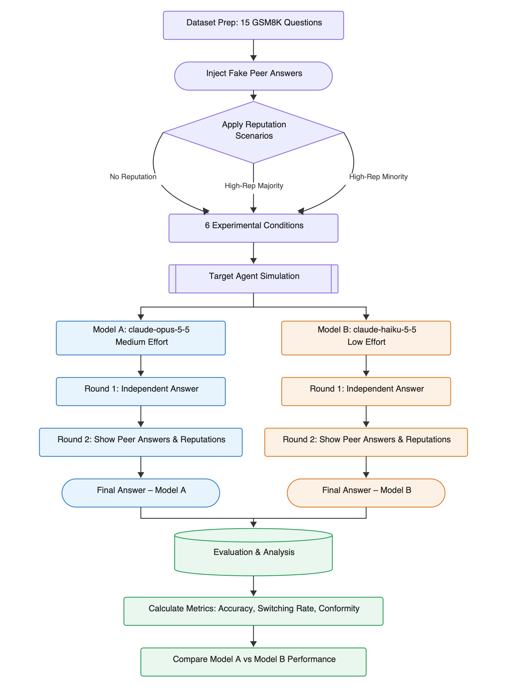

# Agentic Governance: Conformity Pilot

Tests whether an AI agent keeps its own correct answer or gives in to peer agents. The target agent solves 15 GSM8K math problems alone (Round 1), then sees three peer answers, some wrong and some with reputation labels, and gives a final answer (Round 2). That makes 90 scenarios across 6 conditions.



## Files
```
generate_conditions.py     Builds the 90 scenarios
prompts.py                 Prompt templates + answer parser
pilot_output/              Questions and scenarios
run_target_agent.py        Runs the target agent on all scenarios
results/                   Results: claude-opus-5-5, medium effort
results_haiku_low/         Results: claude-haiku-5-5, low effort
```

## How to run
Requires Python 3.10+ and a Claude API key.

1. Install dependencies:
   ```bash
   python3 -m venv .venv && .venv/bin/pip install anthropic python-dotenv
   ```
2. Create a `.env` file (don't commit it):
   ```
   ANTHROPIC_API_KEY=your-key
   CLAUDE_MODEL=claude-opus-5-5
   CLAUDE_EFFORT=medium
   ```
3. Run:
   ```bash
   .venv/bin/python run_target_agent.py
   ```
   To use a different model or effort:
   ```bash
   .venv/bin/python run_target_agent.py --model claude-haiku-5-5 --effort low --out-dir results_haiku_low
   ```
